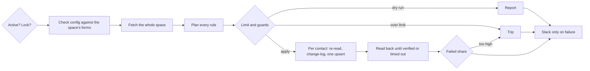

# Contact rules: design

One scheduled job per space applies every contact rule the space has on, from one fetch of the space and with one upsert per changed contact:

- **Household match**: when a canvasser records a Presence on one contact, every other contact at that address gets the household Presence value, so the household is not knocked again. The plan is [issue #1](https://github.com/TrellisCommons/qomon-automations/issues/1).
- **Deceased**: a contact marked deceased gets Qomon's "Do not contact", which stops email, calls, and door knocks.

This doc records how the code implements them and why. Operating the job is in [the runbook](runbook.md). Qomon facts it relies on are in [the Qomon API notes](../integrations/qomon-api.md).

## Flow

Code: `apps/automations/src/jobs/contact-rules/` (`household.ts`, `presence.ts`, and `deceased.ts` are pure; `run.ts` does the I/O), the address key in `packages/address-match-core`.

## Household match rules

1. A contact that already has any Presence value is never modified.
2. When a contact at an address has a canvassed Presence value, every other contact at that address without a Presence gets the space's household value (`absent`), marked with the space's marker (custom field **Presence source** = `household_match`). Every contact counts, not only voters.
3. Written values are never revisited.

A household value written by an earlier run is a Presence, so rule 1 protects it, and the job recognises it as its own (see "Telling the job's writes from knocks" below), so it never triggers rule 2. Each run is therefore idempotent: it plans only what is still missing, which in steady state is the doors knocked since the last run.

Two contacts share an address when their [address keys](../../packages/address-match-core/README.md) are equal. A contact with no street number or street name has no key and is never matched (counted as `unkeyable`).

## Deceased rules

1. A contact is marked deceased when the space's deceased field (a custom field, `Space.deceasedField`) holds the deceased value (`deceasedValue`) and no other value. Every contact in the space counts; the municipality applies only to the household match.
2. A marked contact that is not "Do not contact" (`black_list`) gets it turned on, once per marking.
3. The rule never turns "Do not contact" off and never changes the deceased field.

"Once per marking" is kept in `handled_deceased`. A contact goes in when the job's write is verified (`WRITTEN`), or when a run first sees it marked and already "Do not contact" (`FOUND`). A handled contact is left alone, so a person who turns "Do not contact" off wins. It comes out when a run sees it no longer marked, so marking it again acts again. Qomon's UI only lets the deceased field be edited once "Do not contact" is off, so a correction already happens in that order.

Edge cases:

| Contact | Rule does |
|---|---|
| Deceased value plus another value of a checkbox (for example "NOT deceased") | nothing, counted `deceasedAmbiguous`; a handled contact stays handled |
| Only another value | nothing, counted `deceasedOtherValue` for cleanup by hand (an upsert cannot clear a custom field) |
| Handled, then unmarked and marked again between two runs | stays handled: the run never saw it unmarked |
| Handled `WRITTEN`, now unmarked, still "Do not contact" | forgotten, and listed in Slack for a person to decide; the job does not turn it off |
| Duplicate record of the same person | not touched; the rule reads only the deceased field |

## Decisions

- **One job, one fetch, one upsert per contact.** Every rule plans from the same fetch, and a contact with changes from several rules gets them in one upsert. Qomon applies a record whole or drops it whole, and two upserts to one contact in quick succession can leave it with duplicate answers (see the [Qomon API notes](../integrations/qomon-api.md)). Each change is still its own `planned_write` row, re-checked, change-logged, and verified on its own.
- **Per-space config, checked at start.** A space holds its canvassed values (an allowlist of stored values, not labels), its household value, its marker field and value, and, for the deceased rule, its deceased field and value. Every run checks them against the space's Presence form and custom fields before planning and fails if one is missing, the marker field is not single choice, or the deceased field is not a checkbox or single choice, because Qomon drops an upsert naming an unknown value without an error. A value Qomon adds later does nothing until someone adds it to the allowlist.
- **`absent` plus a marker, not a new Presence value.** Qomon's Presence values are a fixed list that the API cannot extend (see the [Qomon API notes](../integrations/qomon-api.md)), so the job writes `absent` and, in the same upsert, the **Presence source** custom field set to `household_match`. Qomon applies a record whole or drops it whole, so the value never lands without its marker, and verification requires both. Canvass reports still count these contacts as absent; filtering on the marker separates them.
- **Telling the job's writes from knocks.** The household value is also a canvassed value, so the job must recognise its own. An `absent` is the job's when it carries the marker **and** its Presence date is still the one the job recorded when it verified the write (`PlannedWrite.writtenPresenceDate`). A canvasser who records Presence again replaces it with a new date but does not clear the marker (the custom field has no date), so a moved date means a real knock, which triggers the household like any other. A marked `absent` the job has no record of (a rebuilt database) counts as the job's: missing a newly added contact is better than the job triggering off its own writes. An unmarked `absent`, or a marked contact with any other value, is a knock.
- **Re-marking after a visit.** An upsert cannot clear a custom field, and the job never uses the full-replace `PATCH` (it would overwrite anything written between the read and the write), so once a person records Presence on a contact the job wrote (another value, or `absent` with a moved date), the next run changes its marker to `recanvassed`. The update touches only the custom field, never Presence, and goes through the same re-read, change log, and verification as a household write, counting toward the write limit (`PlannedWrite.field` is `presence_source`). So a filter on "Household match" means an automated `absent` nobody has visited since, at most one run out of date, and `recanvassed` keeps the history. A re-marked contact is an ordinary knock to the job.
- **One search per run, filtered in code.** Search returns each contact's Presence inline, and its `eql` is a token match, so the job fetches the whole space and applies the municipality filter itself. A contact whose city is blank is in scope.
- **The earliest canvassed Presence at an address is the trigger.** Its id is on every planned write. Qomon cannot set a Presence date, so the written date is when the write landed.
- **Re-read before each write.** Presence is one value per contact and an upsert replaces it, so a visit recorded between the fetch and the write would be overwritten. Each contact is re-read just before its upsert, and each of its changes is dropped if it no longer applies: a household value if the contact now has a Presence or its address key changed, a "Do not contact" if the contact is no longer marked deceased or is already "Do not contact". This narrows the race to a few seconds; Qomon has no conditional write to close it.
- **"Do not contact" is only turned on.** An upsert cannot turn it off, and whether a contact is alive is a person's call. When the mark is removed from a contact the job blacklisted and it is still "Do not contact", Slack lists it once.
- **Deceased state is recorded on dry runs too.** Adding `FOUND` contacts and forgetting unmarked ones records what Qomon shows, not a change to Qomon, so it happens on every run. Otherwise a space with writes off would miss the unmarking it needs to act again later.
- **Verify every write.** Upsert answers 202 before doing anything. Writes go in batches of 20 contacts; each batch is read back every 3 seconds until every write shows (a household value with its marker, recording its Presence date; a re-mark; "Do not contact" on), shows something else (failed), or `VERIFY_TIMEOUT_SECONDS` passes (failed).
- **Change log before the upsert.** Each write's `ChangeLogEntry` (for a household value, before: no Presence, after: the value and the trigger; for "Do not contact", before: off, after: on) is committed before the upsert is sent, so the audit trail never misses a write that reached Qomon. A write that then fails is marked `FAILED` on its `PlannedWrite`. The change-log table is append-only (a database trigger).
- **Backfill is the same run with an explicit limit.** The first run over a space with weeks of canvassing, or the first run with the deceased rule on over a space with many marked contacts, plans far more than `MAX_WRITES_PER_RUN`; every rule's writes count toward it. `--backfill` records the run as a backfill and requires `--max-writes` to apply. Over that limit it writes nothing but leaves the space on, since a person chose the number.
- **Stopping and restarting are routine.** A backfill runs for many minutes, so a run must survive being stopped. SIGINT or SIGTERM lets the write in hand finish, verifies the writes already sent, marks unattempted ones `SKIPPED`, and ends the run `INTERRUPTED` (exit 3). A run killed outright stays `RUNNING`. The next run, once it holds the lock (proof the old one is dead), reads back that run's unverified writes, records each as `VERIFIED` or `FAILED`, and marks the old run `INTERRUPTED`. Either way the next run re-plans from a fresh fetch, so it picks up exactly what is still missing; there is no resume cursor to get wrong.
- **Progress is saved after every batch.** `stats.progress` on the run holds done, total, writes per minute, and an ETA; `job status` shows it.
- **Slack only on failure or a decision.** A run posts when a write failed, the run failed, or a breaker tripped, and when a contact needs a person's decision (above); nothing else, so the channel stays quiet enough that a message means something. A stop on purpose (Ctrl-C, `systemctl stop`) posts nothing. A run that never reports at all (a dead timer, a run killed by its timeout) shows up as a missed or failed health check ping instead.
- **A dedicated lock connection.** The advisory lock is held on its own `pg` connection, not Prisma's pool, so the unlock lands on the same session and a crashed run's lock goes with its connection.

## Write guards and circuit breakers

A write reaches Qomon only when `QOMON_WRITES_ALLOWED=true` (the droplet only), the space's `writesEnabled` is on (change-logged), and the run has `--apply`. Otherwise the run plans and reports. Turning a space on is refused where the environment does not allow writes.

| Breaker | Trips when | Then |
|---|---|---|
| Write limit (hourly) | planned writes exceed `MAX_WRITES_PER_RUN` (or `--max-writes`) | nothing written; space writes turned off; Slack alert; exit 2 |
| Write limit (backfill) | planned writes exceed `--max-writes` | nothing written; space left on; exit 2 |
| Failed share | at least `MIN_WRITES_FOR_FAILED_SHARE` writes attempted and more than `MAX_FAILED_SHARE` of them failed, checked after each batch | the run stops; space writes turned off; Slack alert; exit 2 |

## Storage

| Table | Holds |
|---|---|
| `space` | config, the encrypted Qomon API key (AES-256-GCM with `SPACE_SECRET_KEY`), `writesEnabled`, `activeUntil` |
| `job_run` | one row per run: kind (hourly or backfill), whether it applied, status, counts |
| `planned_write` | one row per planned change: Qomon contact id, field (`presence`, `presence_source`, `black_list`), trigger contact id, value, reason, outcome |
| `handled_deceased` | deceased contacts the rule has dealt with: Qomon contact id, `WRITTEN` or `FOUND`, the run |
| `change_log_entry` | append-only audit trail of every change to Qomon or to a space |

No names, addresses, or Presence values of other contacts are stored: only Qomon ids, the trigger's value in the reason, and counts.

## Open questions

- Whether a Presence recorded from a phone or event campaign lands in the same form as a door knock (see the [Qomon API notes](../integrations/qomon-api.md)). If it does, rule 2 also fires for phoned contacts.
- Whether "Presence does exist" in Qomon's list builder agrees with what the job counts as having a Presence. Compare a dry run's counts with the list builder before turning writes on.
