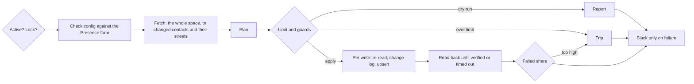

# Household match: design

When a canvasser records a Presence on one contact, every other contact at that address gets the household Presence value, so the household is not knocked again. The plan is [issue #1](https://github.com/TrellisCommons/qomon-automations/issues/1); this doc records how the code implements it and why. Operating it is in [the runbook](runbook.md). Qomon facts it relies on are in [the Qomon API notes](../integrations/qomon-api.md).

## Flow

Code: `apps/automations/src/jobs/household-match/` (`plan.ts` is pure; `run.ts` does the I/O), the key in `packages/address-match-core`.

## Run rules

1. A contact that already has any Presence value is never modified.
2. When a contact at an address has a canvassed Presence value, every other contact at that address without a Presence gets the space's household value (`absent`), marked with the space's marker (custom field **Presence source** = `household_match`). Every contact counts, not only voters.
3. Written values are never revisited.

A household value written by an earlier run is a Presence, so rule 1 protects it, and the job recognises it as its own (see "Telling the job's writes from knocks" below), so it never triggers rule 2. Each run is therefore idempotent: it plans only what is still missing, which in steady state is the doors knocked since the last run.

Two contacts share an address when their [address keys](../../packages/address-match-core/README.md) are equal. A contact with no street number or street name has no key and is never matched (counted as `unkeyable`).

## Decisions

- **Per-space config, checked at start.** A space holds its canvassed values (an allowlist of stored values, not labels), its household value, and its marker field and value. Every run checks them against the space's Presence form and custom fields before planning and fails if one is missing or the marker field is not single choice, because Qomon drops an upsert naming an unknown value without an error. A value Qomon adds later does nothing until someone adds it to the allowlist.
- **`absent` plus a marker, not a new Presence value.** Qomon's Presence values are a fixed list that the API cannot extend (see the [Qomon API notes](../integrations/qomon-api.md)), so the job writes `absent` and, in the same upsert, the **Presence source** custom field set to `household_match`. Qomon applies a record whole or drops it whole, so the value never lands without its marker, and verification requires both. Canvass reports still count these contacts as absent; filtering on the marker separates them.
- **Telling the job's writes from knocks.** The household value is also a canvassed value, so the job must recognise its own. An `absent` is the job's when it carries the marker **and** its Presence date is still the one the job recorded when it verified the write (`PlannedWrite.writtenPresenceDate`). A canvasser who records Presence again replaces it with a new date but does not clear the marker (the custom field has no date), so a moved date means a real knock, which triggers the household like any other. A marked `absent` the job has no record of (a rebuilt database) counts as the job's: missing a newly added contact is better than the job triggering off its own writes. An unmarked `absent`, or a marked contact with any other value, is a knock.
- **Re-marking after a visit.** A custom field cannot be cleared through the API, so once a person records Presence on a contact the job wrote (another value, or `absent` with a moved date), the next run changes its marker to `recanvassed`. The update touches only the custom field, never Presence, and goes through the same re-read, change log, and verification as a household write, counting toward the write limit (`PlannedWrite.field` is `presence_source`). So a filter on "Household match" means an automated `absent` nobody has visited since, at most one run out of date, and `recanvassed` keeps the history. A re-marked contact is an ordinary knock to the job.
- **Filtered in code.** Search returns each contact's Presence inline, and its `eql` is a token match, so the job applies the municipality filter and the address key itself. A contact whose city is blank is in scope.
- **Full runs and incremental runs.** A full run fetches the whole space, one search request per 1,000 contacts. An incremental run (`--incremental`), meant to run every minute, fetches only what can have changed:
  1. contacts whose `UpdatedAt` is at or after the space's cursor less 5 minutes (`CURSOR_OVERLAP_MS`). Any change moves `UpdatedAt`, a canvasser's Presence included, and it is when Qomon received the change, so a knock synced late is still found. The overlap covers clock skew and search trailing writes by a few seconds; re-reading a contact is harmless.
  2. the other members of the households of those changed contacts that could start or join a household match: not the job's own writes, in the municipality, with an address key. Each street is searched with `address.street start_with` its first word, in the stored case, lower case, and capitalized, and with each changed household's number in front for contacts whose number is in the street field. Only results whose address key is one of the changed households are kept.

  Planning, guards, and writing are then the same as a full run. An incremental run can miss a write (a housemate whose street starts with a different word), but never adds one a full run would not, since every member it plans over really is in the household. More than `MAX_CHANGED` (2,000) changed contacts, or no cursor yet, and it fetches the whole space instead (`stats.fallback` says why); it stops reading changed contacts as soon as it passes the limit. The hourly full run stays: it catches what incremental runs miss and retries what they left undone.
- **The cursor moves once a run has planned.** `space.changedCursor` is set to when the run sent its first search as soon as the plan is saved, whether or not its writes land. A write left undone (a dry run, writes off, a failed write, a trip, an interruption) is the next full run's, within the hour, so one stuck write never holds incremental runs back or pushes them into a full fetch every minute. A run that fails before it plans leaves the cursor, and the next run searches from the same point.
- **A full run waits for the lock.** An incremental run holding the lock is usually done within seconds, so a full run polls for it for up to 10 minutes instead of exiting. If it still cannot get it, it posts to Slack and exits 1, rather than letting the hour's full run pass unnoticed. An incremental run that finds the lock taken exits at once; the next one is a minute away.
- **The earliest canvassed Presence at an address is the trigger.** Its id is on every planned write. Qomon cannot set a Presence date, so the written date is when the write landed.
- **Re-read before each write.** Presence is one value per contact and an upsert replaces it, so a visit recorded between the fetch and the write would be overwritten. Each target is re-read just before its write and skipped if it now has a Presence or its address key changed. This narrows the race to a few seconds; Qomon has no conditional write to close it.
- **Verify every write.** Upsert answers 202 before doing anything. Writes go in batches of 20; each batch is read back every 3 seconds until every write shows the household value with its marker (verified, recording its Presence date), shows another value or no marker (failed), or `VERIFY_TIMEOUT_SECONDS` passes (failed).
- **Change log before the upsert.** Each write's `ChangeLogEntry` (before: no Presence; after: the household value and the trigger) is committed before the upsert is sent, so the audit trail never misses a write that reached Qomon. A write that then fails is marked `FAILED` on its `PlannedWrite`. The change-log table is append-only (a database trigger).
- **Backfill is the same run with an explicit limit.** The first run over a space with weeks of canvassing plans far more than `MAX_WRITES_PER_RUN`. `--backfill` records the run as a backfill and requires `--max-writes` to apply. Over that limit it writes nothing but leaves the space on, since a person chose the number.
- **Stopping and restarting are routine.** A backfill runs for many minutes, so a run must survive being stopped. SIGINT or SIGTERM lets the write in hand finish, verifies the writes already sent, marks unattempted ones `SKIPPED`, and ends the run `INTERRUPTED` (exit 3). A run killed outright stays `RUNNING`. The next run, once it holds the lock (proof the old one is dead), reads back that run's unverified writes, records each as `VERIFIED` or `FAILED`, and marks the old run `INTERRUPTED`. Either way the next run re-plans from a fresh fetch, so it picks up exactly what is still missing; there is no resume cursor to get wrong.
- **Progress is saved after every batch.** `stats.progress` on the run holds done, total, writes per minute, and an ETA; `job status` shows it.
- **Slack only on failure.** A run posts when a write failed, the run failed, or a breaker tripped; nothing else, so the channel stays quiet enough that a message means something. A failed run is not posted when the previous run of the same kind failed with the same error, so an outage under a run every minute posts once, and a new error or a failure of the other kind of run still posts. Incremental runs ping `HEALTHCHECK_URL_INCREMENTAL`, not `HEALTHCHECK_URL`, so their pings every minute cannot cover for a full run that failed or stopped. A stop on purpose (Ctrl-C, `systemctl stop`) posts nothing. A run that never reports at all (a dead timer, a run killed by its timeout) shows up as a missed or failed health check ping instead.
- **A dedicated lock connection.** The advisory lock is held on its own `pg` connection, not Prisma's pool, so the unlock lands on the same session and a crashed run's lock goes with its connection.

## Write guards and circuit breakers

A write reaches Qomon only when `QOMON_WRITES_ALLOWED=true` (the droplet only), the space's `writesEnabled` is on (change-logged), and the run has `--apply`. Otherwise the run plans and reports. Turning a space on is refused where the environment does not allow writes.

| Breaker | Trips when | Then |
|---|---|---|
| Write limit (hourly) | planned writes exceed `MAX_WRITES_PER_RUN` (or `--max-writes`) | nothing written; space writes turned off; Slack alert; exit 2 |
| Write limit (backfill) | planned writes exceed `--max-writes` | nothing written; space left on; exit 2 |
| Failed share | at least `MIN_WRITES_FOR_FAILED_SHARE` writes attempted and more than `MAX_FAILED_SHARE` of them failed, checked after each batch | the run stops; space writes turned off; Slack alert; exit 2 |

## Storage

| Table | Holds |
|---|---|
| `space` | config, the encrypted Qomon API key (AES-256-GCM with `SPACE_SECRET_KEY`), `writesEnabled`, `activeUntil`, the incremental cursor `changedCursor` |
| `job_run` | one row per run: kind (hourly, backfill, or incremental), whether it applied, status, counts, and what was fetched (`scope`, `changed`, `streets`, `fallback`) |
| `planned_write` | one row per planned change: Qomon contact id, trigger contact id, value, reason, outcome |
| `change_log_entry` | append-only audit trail of every change to Qomon or to a space |

No names, addresses, or Presence values of other contacts are stored: only Qomon ids, the trigger's value in the reason, and counts.

## Open questions

- Whether a Presence recorded from a phone or event campaign lands in the same form as a door knock (see the [Qomon API notes](../integrations/qomon-api.md)). If it does, rule 2 also fires for phoned contacts.
- Whether "Presence does exist" in Qomon's list builder agrees with what the job counts as having a Presence. Compare a dry run's counts with the list builder before turning writes on.
