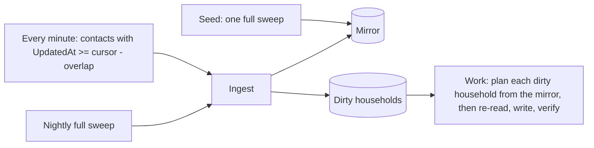

# Household match: incremental design (proposed)

Status: **proposed, not built.** The current job ([design](design.md)) fetches the whole space every run, which takes about 1 second per 1,000 contacts. A 500,000-contact space would take 8 to 9 minutes and about 500 requests per run, so it cannot run every minute: the run outlasts the interval and the requests alone use most of Qomon's rate limit (a burst of 100, refilling at 10 per second; see the [Qomon API notes](../integrations/qomon-api.md)). This design processes only what changed. The run rules, the write path, and the guards are unchanged.

## Shape

Each run has two phases with separate progress.

1. **Ingest.** Search `UpdatedAt >= cursor - overlap`, update those contacts' mirror rows, and mark their old and new household keys dirty (a contact who moved affects both addresses). The mirror rows, the dirty marks, and the new cursor commit in **one transaction**, so the cursor means "the mirror is current up to here" and never waits on a write.
2. **Work.** Take dirty households that are due, plan each from the mirror with the existing rules, and apply through the existing path: re-read before writing, change log, upsert, verify. A household leaves the dirty table only when its writes have settled.

The job's own writes bump `UpdatedAt`, so they come back through the next ingest and keep the mirror honest.

## Storage

| Table | Holds |
|---|---|
| `contact_mirror` | per contact: id, `UpdatedAt`, in-municipality flag, household key as an HMAC with `SPACE_SECRET_KEY` (no address is stored), Presence refvalue and date, marker value |
| `dirty_household` | household HMAC, `attempts`, `nextAttemptAt`, `lastError`, `quarantinedAt` |
| `sync_cursor` | per space and job: the cursor, and when it last moved |

## Scheduling

A minutely systemd timer with `Type=oneshot` never starts a second copy: a tick that comes due while a run is still going is dropped, not queued. A burst (thousands of writes after an outage) is one long run that skips ticks, then runs return to about a second each. Settings: `OnCalendar=minutely`, `AccuracySec=1s` (the default of 1 minute would let each start drift up to a minute), no `RandomizedDelaySec`, `TimeoutStartSec=2h`, and `TimeoutStopSec=5min` for the graceful stop. The advisory lock stays, for manual runs.

On Kubernetes the equivalent is a CronJob with `concurrencyPolicy: Forbid`, `startingDeadlineSeconds` set (without it, more than 100 missed ticks during a long run stops the CronJob for good), `activeDeadlineSeconds` for the timeout, `terminationGracePeriodSeconds` long enough for the graceful stop, and `backoffLimit: 0`. If pod start-up cost matters at one-minute ticks, a single-replica Deployment running a loop (with `strategy: Recreate`) is the alternative.

## Failure handling

- **One contact never sinks a run.** Anything specific to a contact is recorded and the run moves on: a 404, a validation error, a verification timeout, and a contact that fails to parse. The client validates search results contact by contact, setting malformed ones aside with their id and error, instead of failing the whole page. Only failures of the whole system fail a run (authentication, repeated 5xx after retries, the database), and those should stall and alert.
- **Back-off, then quarantine.** A household whose processing fails gets exponential back-off (1, 2, 4 minutes and so on) while others keep flowing. After 5 attempts it is quarantined: never retried automatically, alerted once, and released by a person with `job release`.
- **Nightly reconciliation sweep.** A full sweep through the same ingest catches what `UpdatedAt` cannot: deleted contacts (they vanish without notice) and any change that does not bump `UpdatedAt`. Anything that differs from the mirror is marked dirty.
- **The circuit breakers stay**, as sanity limits rather than throttles (see Alerts).

## Alerts

Slack hears only about failures and anomalies (as in the current job), each **once per problem**: when it starts, and once when it clears. A problem that persists does not post every minute.

| Alert | Fires when | Why |
|---|---|---|
| Breaker: implausible plan | one run plans more than `MAX_WRITES_PER_RUN` (set high, for example 5,000); writes are turned off | something is wrong with the plan, not with the load |
| Breaker: failed share | more than `MAX_FAILED_SHARE` of a run's writes fail; writes are turned off | Qomon is dropping writes or the config drifted |
| Config check failed | the Presence form or the marker field no longer has a configured value | the job stops planning until fixed |
| Ingest lag | the cursor has not moved for 10 minutes | the job is stalled, or failing in a way that is not an error |
| Work lag | the oldest due, non-quarantined dirty household is older than 15 minutes | writes are falling behind |
| Quarantine | a household is quarantined | a person needs to look |
| Change spike | one ingest sees far more changed contacts than usual (for example a bulk import touching 100,000 contacts) | not a failure, but processing will run long; the alert says roughly how long |
| Write spike | writes in the last hour are several times the trailing daily average | a feedback loop, or a bulk change upstream |
| Rate limiting | Qomon returned 429s in a run | the pace or another client is using up the shared limit |
| Sweep drift | the nightly sweep finds more than a handful of contacts the minutely ingest missed | `UpdatedAt` is not catching some kind of change; the incremental job is not trustworthy until explained |
| Shadow difference | during rollout, the incremental and full planners disagree | see Rollout |

The health check ping carries cursor age, work lag, and the quarantine count, so a dead timer or a silent stall shows up there too.

## Verify before building

1. **A Presence recorded in the canvassing app bumps `UpdatedAt`.** API writes do (sandbox, 2026-10-07). If the app does not, knocks are only seen by the nightly sweep and this design does not work. Needs someone to record a Presence on a test contact in the app.
2. **How long a change takes to appear in an `UpdatedAt` search.** General search lag was a few seconds; the overlap should be at least five times the measured lag.
3. **Address edits and custom field writes bump `UpdatedAt`.** Testable through the API.
4. **Whether the rate limit is per API key or shared with the canvassing apps.**

`UpdatedAt >= T` works to the second (test space, 2026-10-11): `gte` and `range` on `UpdatedAt` return exactly the contacts updated in the window. `lastchange` does not move on API writes and is not usable.

## Proving it matches the current job

- **Property test:** random sequences of knocks, re-records, moves, new contacts, and deletions against the fake. After each step, the incremental planner's writes must equal the full planner's.
- **Shadow rollout:** the incremental job runs every minute as a dry run while the hourly job keeps writing. Any plan difference alerts. Switch over after a clean day.

## Cost

About two days of building and testing, plus the app check in "Verify before building". The per-contact parsing change is worth making to the current job regardless: one malformed contact would fail every hourly run today.
