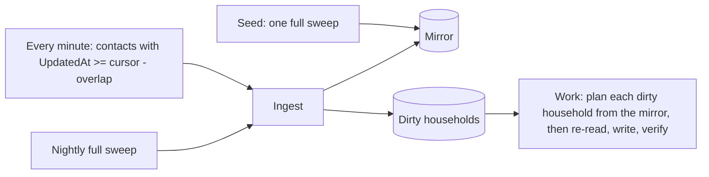

# Household match: incremental design

Status: **built, not yet in use.** `household-match --incremental` and `--sweep` implement this design alongside the full job; how to run them is in [the runbook](runbook.md#incremental-job). The full job ([design](design.md)) fetches the whole space every run, which takes about 1 second per 1,000 contacts. A 500,000-contact space would take 8 to 9 minutes and about 500 requests per run, so it cannot run every minute: the run outlasts the interval and the requests alone use most of Qomon's rate limit (a burst of 100, refilling at 10 per second; see the [Qomon API notes](../integrations/qomon-api.md)). This design processes only what changed. The run rules, the write path, and the guards are unchanged.

## Shape

Each run has two phases with separate progress.

1. **Ingest.** Search `UpdatedAt >= cursor - overlap`, update those contacts' mirror rows, and mark their old and new household keys dirty (a contact who moved affects both addresses), 1,000 contacts at a time. The cursor is written **last**, after every page is in the mirror and its households are marked, so it means "the mirror is current up to here" and never waits on a write. A run that dies part-way re-reads the same window next time; mirror updates and dirty marks are idempotent. The first run, or `--sweep`, reads every contact instead, sets the cursor to when the sweep started, and removes mirror rows for contacts Qomon no longer has. Paging is by live offset, so a contact can be missing from a sweep's listing without being deleted: each missing contact is read directly and removed only on a 404, and a sweep missing more than `SWEEP_MAX_DELETES` (500) removes none and alerts. A delta that takes more than one page reads its window a second time before the cursor moves, adding only contacts the first pass missed, since a contact shifted past a page boundary may have a change older than the next window. A change to anything mirror rows are derived from (`SPACE_SECRET_KEY`, the municipality, or the Presence or marker form, detected by a fingerprint in `sync_cursor`) forces a sweep, which re-derives every contact in one run rather than planning from stale rows until the next sweep.
2. **Work.** Take up to `INCREMENTAL_MAX_HOUSEHOLDS_PER_RUN` (1,000) dirty households that are due, longest-due first, so a burst drains over several runs. Plan each from the mirror with the existing rules, and apply through the existing path: re-read before writing, change log, upsert, verify. A household leaves the dirty table only when its writes have settled. A run that cannot write settles the households that need nothing and defers the rest by `DRY_RUN_RECHECK_MINUTES` (60), so they are not re-planned and re-saved every minute. A dry run (no `--apply`) defers them only for other dry runs (`dryRunAfter`), so inspecting a plan, or a shadow day, never delays the applying job. An applying run blocked by writes being off defers them for everyone; turning writes on with `space:writes --on` makes them due at once.

The job's own writes bump `UpdatedAt`, so they come back through the next ingest and keep the mirror honest.

## Storage

| Table | Holds |
|---|---|
| `contact_mirror` | per contact: id, `UpdatedAt`, in-municipality flag, household key as an HMAC with `SPACE_SECRET_KEY` (no address is stored), Presence refvalue and date, marker value |
| `dirty_household` | household HMAC, `markedAt`, `attempts`, `nextAttemptAt`, `lastError`, `quarantinedAt` |
| `sync_cursor` | per space and job: the cursor (the newest `UpdatedAt` ingested), when ingest last completed, when the last sweep ran, and a fingerprint of what mirror rows are derived from (hash key, municipality, form ids) |
| `alert_state` | alerts already posted, so each posts once |

A contact with no usable address is a household of one (`solo:<contact id>`), so a marker on it can still be re-marked.

## Scheduling

A minutely systemd timer with `Type=oneshot` never starts a second copy: a tick that comes due while a run is still going is dropped, not queued. A burst (thousands of writes after an outage) is one long run that skips ticks, then runs return to about a second each. Settings: `OnCalendar=minutely`, `AccuracySec=1s` (the default of 1 minute would let each start drift up to a minute), no `RandomizedDelaySec`, `TimeoutStartSec=2h`, and `TimeoutStopSec=5min` for the graceful stop. The advisory lock stays, for manual runs. The nightly sweep shares it with the minutely run, so a sweep that finds it taken waits up to 15 minutes for it; if it still cannot get it, it exits non-zero, so the health check reports it rather than the sweep being skipped for the day.

On Kubernetes the equivalent is a CronJob with `concurrencyPolicy: Forbid`, `startingDeadlineSeconds` set (without it, more than 100 missed ticks during a long run stops the CronJob for good), `activeDeadlineSeconds` for the timeout, `terminationGracePeriodSeconds` long enough for the graceful stop, and `backoffLimit: 0`. If pod start-up cost matters at one-minute ticks, a single-replica Deployment running a loop (with `strategy: Recreate`) is the alternative.

## Failure handling

- **One contact never sinks a run.** Anything specific to a contact is recorded and the run moves on: a 404, a validation error, a verification timeout, and a contact that fails to parse, whether in a search or when re-read before a write. The client validates search results contact by contact, setting malformed ones aside with their id and error, instead of failing the whole page. A Qomon error re-reading or verifying one contact fails that write, so its household backs off and quarantines; errors on 3 contacts in a row mean Qomon itself is failing, and fail the run. Only failures of the whole system fail a run (authentication, repeated 5xx after retries, the database), and those should stall and alert rather than quarantine every household they touch.
- **Back-off, then quarantine.** A household with a failed write gets exponential back-off (1, 2, 4 minutes and so on) while others keep flowing. After `QUARANTINE_AFTER_ATTEMPTS` (5) it is quarantined: never retried automatically, alerted, and released by a person with `job release --space <key> --contact <id>` (or `--household <hash>`). A household whose writes were cut short by a stop stays dirty without counting as a failure.
- **Nightly reconciliation sweep.** A full sweep through the same ingest catches what `UpdatedAt` cannot: deleted contacts (they vanish without notice) and any change that does not bump `UpdatedAt`. Anything that differs from the mirror is marked dirty.
- **The circuit breakers stay**, as sanity limits rather than throttles (see Alerts).

## Alerts

Slack hears only about failures and anomalies (as in the current job), each **once per problem** (`src/alerts.ts`). A *condition* posts when it starts and once when it clears. An *event* posts when it happens, then stays quiet for a cooldown even if it recurs. A failed run's event is keyed on its error with the numbers taken out, so the same failure on a different contact is the same problem.

| Alert | Fires when | Why |
|---|---|---|
| Breaker: implausible plan | one run plans more than `INCREMENTAL_MAX_WRITES_PER_RUN` (5,000) for its capped batch of households; writes are turned off | something is wrong with the plan, not with the load |
| Breaker: failed share | more than `MAX_FAILED_SHARE` of a run's writes fail; writes are turned off | Qomon is dropping writes or the config drifted |
| Config check failed | the Presence form or the marker field no longer has a configured value | the job stops planning until fixed |
| Ingest lag | the cursor has not moved for 10 minutes | the job is stalled, or failing in a way that is not an error |
| Work lag | a non-quarantined dirty household has been due for more than 15 minutes (measured from `nextAttemptAt`, so one backing off after a failure does not count) | writes are falling behind |
| Quarantine | a household is quarantined | a person needs to look |
| Change spike | one ingest sees far more changed contacts than usual (for example a bulk import touching 100,000 contacts) | not a failure, but processing will run long; the alert says roughly how long |
| Write spike | over 200 writes in the last hour, and over five times the hourly average of the 23 hours before | a feedback loop, or a bulk change upstream |
| Rate limiting | Qomon returned 429s in a run | the pace or another client is using up the shared limit |
| Sweep deletions refused | a sweep's listing is missing more than `SWEEP_MAX_DELETES` known contacts; none are deleted | a short or broken listing, or a mass deletion that a person should confirm |
| Sweep drift | the nightly sweep finds more than a handful of contacts the minutely ingest missed | `UpdatedAt` is not catching some kind of change; the incremental job is not trustworthy until explained |
| Writes off | the environment and the run would write, but the space's writes are off (a condition; a manual dry run neither raises nor clears it) | runs only plan until a person turns writes back on |
| Invalid contacts | contacts failed validation and were set aside | a malformed record; ids are in the logs |

A post that Slack refuses is not recorded, so the next run tries it again. An error while alerting is logged and never changes the run's recorded outcome.

The quarantine alert is one condition for the space (it posts when the first household is quarantined and clears when none are), not one per household. There is no separate shadow-difference alert: sweep drift is the check that the mirror matches Qomon.

The incremental job and the sweep each ping their own health check (`HEALTHCHECK_URL_INCREMENTAL`, `HEALTHCHECK_URL_SWEEP`), so a minutely success never covers for a failed or missing sweep. The ping carries cursor age, work lag, and the quarantine count, so a dead timer or a silent stall shows up there too.

A minutely job writes 1,440 `job_run` rows a day per space. Successful incremental and sweep runs with no planned writes are deleted after 7 days; runs with writes, and failed runs, are kept.

## Verify before building

1. **A Presence recorded in the canvassing app bumps `UpdatedAt`.** API writes do (sandbox, 2026-10-07). If the app does not, knocks are only seen by the nightly sweep and this design does not work. Needs someone to record a Presence on a test contact in the app.
2. **How long a change takes to appear in an `UpdatedAt` search.** General search lag was a few seconds; the overlap should be at least five times the measured lag.
3. **Address edits and custom field writes bump `UpdatedAt`.** Testable through the API.
4. **Whether the rate limit is per API key or shared with the canvassing apps.**

`UpdatedAt >= T` works to the second (test space, 2026-10-11): `gte` and `range` on `UpdatedAt` return exactly the contacts updated in the window. `lastchange` does not move on API writes and is not usable.

## Proving it matches the current job

- **Equivalence test** (`incremental.test.ts`): two fakes receive the same random history of new contacts, knocks, re-records, moves, and deletions. After every step the full job runs against one and the incremental job (a sweep after a deletion, as in production) against the other, and every contact's Presence and marker must match. It runs 12 histories in CI; 80 passed locally.
- **Shadow rollout:** run the incremental job every minute as a **dry run** while the hourly full job keeps writing. A dry run saves the plan for each household that needs writes and checks it again hourly, so its planned writes can be compared with the hourly runs'; watch the sweep drift alert for a day before switching.

## Known limits

- **A deleted contact can trigger writes until the next sweep.** The mirror keeps a deleted canvassed contact until a sweep removes it, so its housemates can be written in the meantime; the full job would not write them. The re-read before every write still protects the housemates' own Presence.
- **A change to the space's municipality** makes the next sweep report every contact it moves in or out of scope as drift.
